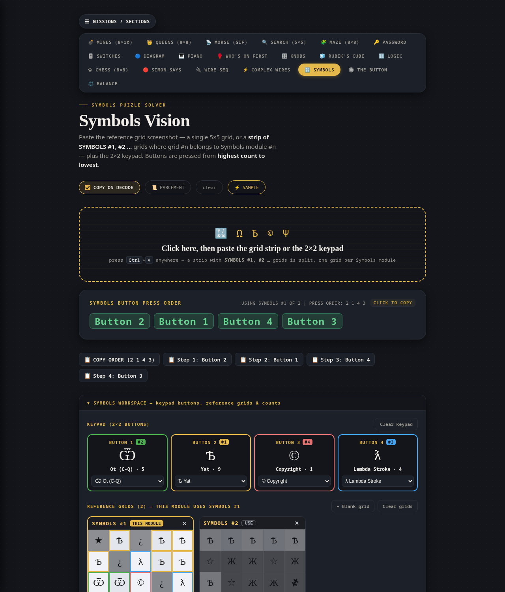

# Bomb Vision

A browser tool that solves the bomb-defusal puzzle modules of a heist minigame from screenshots. Paste a screenshot of a module, the page reads the board with computer vision or OCR, runs a solver, and copies the answer to the clipboard. Everything runs client-side in one static page; Tesseract.js, chess.js and the fonts are loaded from public CDNs.

**Live:** https://bomb-tan-one.vercel.app (`/bomb` for the bomb solver alone). What changed when: [CHANGELOG.md](CHANGELOG.md). Plan for a cheaper captcha model: [docs/ml-roadmap.md](docs/ml-roadmap.md).



*The Symbols module on its built-in sample: two reference grids, the four keypad buttons, and the press order (highest symbol count first).*

## Modules

20 modules, each with its own input, answer, copy buttons and a collapsible view of the solver's working:

| | | | |
|---|---|---|---|
| Mines (8×10) | Queens (8×8) | Morse (GIF) | Word Search (5×5) |
| Maze (8×8) | Password | Switches | Diagram |
| Piano | Who's On First | Knobs | Rubik's Cube |
| Logic | Chess (8×8) | Simon Says | Wire Sequences |
| Complex Wires | Symbols | The Button | Balance |

A missions sidebar groups the modules by level, and the level generator builds that list from a screenshot of the bomb board.

How the pieces work:

- **Vision** (`src/modules/*/*Vision.js`, `src/utils/`): canvas pixel analysis written for each module: grid detection, Otsu thresholding, connected components, colour classification, GIF frame timing for Morse. No ML model.
- **OCR**: Tesseract.js for the modules that read letters (Word Search, Password, Who's On First, Balance).
- **Solvers** (`src/modules/*/*Solver.js`): constraint propagation plus exhaustive frontier search for Mines, iterative-deepening search for the cube, a recursive-descent parser for Logic expressions, rule tables for the manual-driven modules.
- **Chess**: Stockfish (bundled in `public/stockfish.js`) running in a Web Worker.

## Run it

```bash
npm install
npm run dev        # http://localhost:3000
npm run build      # dist/yuza.html (autocopy off by default) + dist/dixie.html (autocopy on), all code inlined
npm test
npm run build:captcha-wasm   # only after editing src/heist/captcha/captchaKernel.c (needs clang)
```

The Heist captcha reader runs its network in WebAssembly SIMD (`src/heist/captcha/captchaKernel.c`, embedded as base64 in `captchaKernelWasm.js`); browsers without WebAssembly SIMD use the plain-JS version of the same network.

Several modules have a **SAMPLE** button that loads a built-in board, so you can see a solver work without a screenshot.

## Deploy (Vercel)

`vercel.json` builds with `npm run build`, then `scripts/lock-site.mjs` locks the result, and serves
`dist/`: `/` shows the dixie build (autocopy on, both games), `/yuza`, `/dixie` and `/bomb` are the three
builds, `/login` the login page, `/admin` the owner's page. `.vercelignore` uploads only what the build and
the login functions need, not the captcha data or conso.

```bash
vercel             # a preview deployment from this folder
vercel --prod      # the live one
```

`vercel` uploads this folder as it is, uncommitted work included. The project is also connected to the
GitHub repo, so a push to `main` deploys that commit to production.

### Login and who can use the site

- **Log in with Discord.** Every page and file of the site needs a logged-in user who is allowed in
  (`middleware.js`); anyone else gets `/login`. Discord only tells the site your ID, name and avatar.
- **`/admin`**, for the Discord IDs in `ADMIN_IDS`: everyone who has logged in, with Allow (no limit),
  Allow for 1 / 7 / 30 days, or Block. A first login gets in straight away (`NEW_USERS=wait` makes it
  wait for you instead). A change applies to that person's next page load.
- **The OGs** (`OG_IDS`: Yuza and Dixie, the first two players): always let in like the owner, also
  while Supabase is paused. Nobody can block or time-limit them (or the owner). They can open `/admin`
  to see who uses the site, but not change anything. They get an **OG** badge by their name and a
  **⚑ WRONG ANSWER?** button under every answer: it sends the answer, the module's pictures and its text
  on screen (what it read), with their note, to your Discord channel (`REPORT_WEBHOOK`). You get the
  button too. Nobody else sees it.
- **Locked code.** On Vercel the app pages keep their HTML and CSS, but their code is encrypted; the
  page asks `/api/unlock` for the key, which only an allowed user on this site gets. A Ctrl+S copy, a
  copy opened from a file or put on another site shows "this copy doesn't run here". Someone who is
  logged in and knows the browser's developer tools can still dig the running code out: no website can
  stop that; what you control is who gets in.
- Only the app pages, `/login` and `stockfish.js` are published; the old pages in `public/` (bombs,
  maze, …) are not.
- A local `npm run build` stays unlocked, as before.

**Setup, once:**

1. **Supabase** (free): new project → SQL Editor → paste `supabase/bomb_users.sql` → Run. Then the
   Project URL, and Project Settings → API Keys → **Secret keys** (`sb_secret_…`, or the legacy
   `service_role`). Not the publishable / anon key Supabase shows for Next.js
   (`NEXT_PUBLIC_SUPABASE_PUBLISHABLE_KEY`): the table is closed to it, and the site says so if it's used.
   `NEXT_PUBLIC_SUPABASE_URL` works in place of `SUPABASE_URL`.
2. **Discord**: discord.com/developers/applications → New Application → OAuth2: copy the Client ID,
   Reset Secret and copy the Client Secret, and under Redirects add
   `https://bomb-tan-one.vercel.app/api/auth/callback`.
3. **Vercel** → project → Settings → Environment Variables (Production):

   | Name | Value |
   |---|---|
   | `SESSION_SECRET` | 64 random characters: `openssl rand -hex 32` |
   | `SUPABASE_URL` | `https://xxxx.supabase.co` |
   | `SUPABASE_SERVICE_KEY` | the **secret** key (`sb_secret_…`) |
   | `DISCORD_CLIENT_ID`, `DISCORD_CLIENT_SECRET` | from step 2 |
   | `ADMIN_IDS` | your Discord user ID, the number (Discord: Settings → Advanced → Developer Mode, then your avatar → Copy User ID; or log in and open `/admin`) |
   | `NEW_USERS` | optional: `wait` |
   | `OG_IDS` | optional: the OGs' Discord user IDs, comma-separated |
   | `REPORT_WEBHOOK` | optional: a Discord webhook link for the ⚑ reports (the channel → Edit Channel → Integrations → Webhooks → New Webhook → Copy Webhook URL) |

4. Redeploy (`vercel --prod`). Environment variables only reach a new deployment.

Every Vercel build starts with `scripts/check-setup.mjs`: it prints ✓ / ✗ for each setting (never a
value; they're Sensitive, so the build is the only place that can see them), checks that Supabase
answers with the `bomb_users` table and that Discord accepts the client ID and secret, and stops the
build if logging in couldn't work. Read it with `vercel inspect <deployment> --logs`.

Without `SESSION_SECRET` the Vercel build stops at the lock step, so the site is never published
unlocked (the last deployment stays live). Changing `SESSION_SECRET` logs everyone out and needs a
redeploy. A free Supabase project pauses after a week without use; while it is paused only the owner
and the OGs get in (`/admin` says so), until it is restored at supabase.com.

## Tests

`npm test` runs 45 tests on the solvers with Node's built-in test runner (no extra dependencies):

- **Mines**: on 2,000 random boards the solver never calls a mine safe or a safe square a mine; on 400 boards small enough to enumerate every mine layout, its output is exactly the set of squares forced by the clues.
- **Morse**: every word in the frequency table decodes correctly, including captures that start mid-word and timings with 20% jitter.
- **Logic**: operator precedence, ASCII operator spellings, all 32 assignments of a five-variable formula, error reporting.
- **Rubik's Cube**: hand-written single-turn scrambles are solved by the inverse turn, with and without hidden stickers.
- **Chess, Password, Word Search, Simon Says**: FEN round trip, candidate filtering, eight-direction search, rule parsing.

Not covered by automated tests: the vision and OCR code, which needs real game screenshots, and the 12 modules not listed above.

## Layout

```text
src/
├── App.jsx, main.jsx
├── core/            shared layout components, contexts, missions data, level generator
├── modules/<name>/  index.jsx (UI), working.jsx (working panel), *Vision.js, *Solver.js
├── styles/
└── utils/           canvas, image, GIF and thresholding helpers
tests/               solver tests, and the website login (auth.test.js)
public/              stockfish.js, login.html, and the original single-file version of the app
api/, lib/           the website's login, /admin and unlock functions (Vercel)
middleware.js        lets only allowed, logged-in users reach the site's pages and files
scripts/lock-site.mjs  encrypts the app pages' code on Vercel
supabase/            the users table
```

`migration.md` documents the shared component API and how to add a module.
