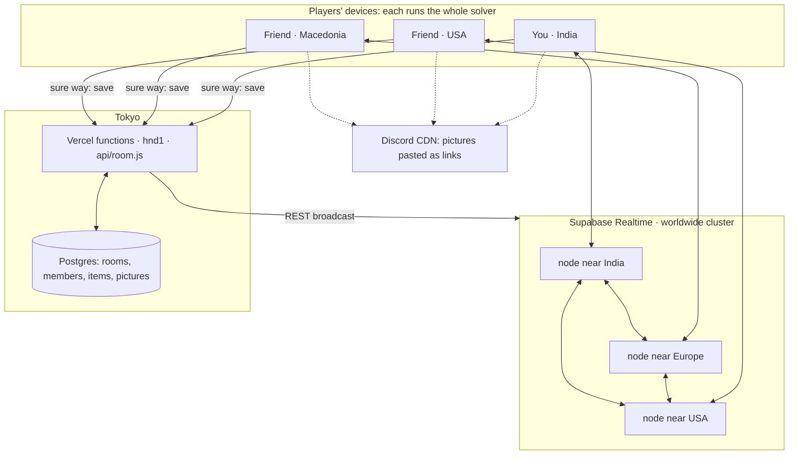
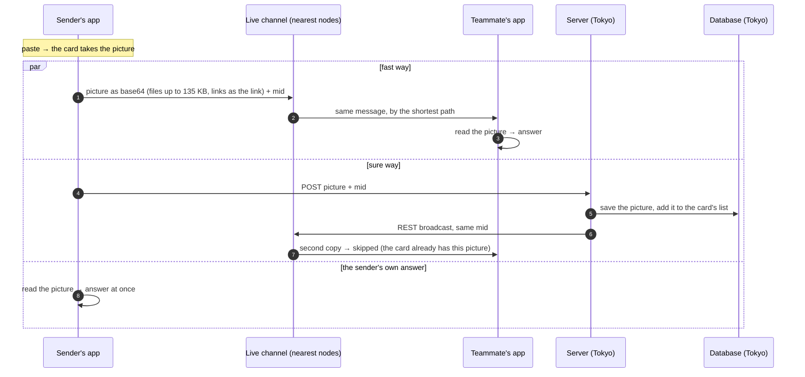
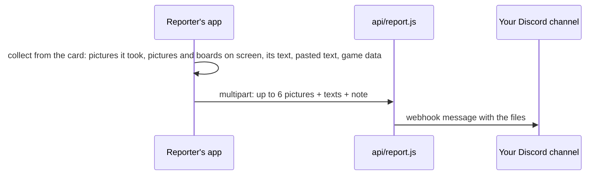
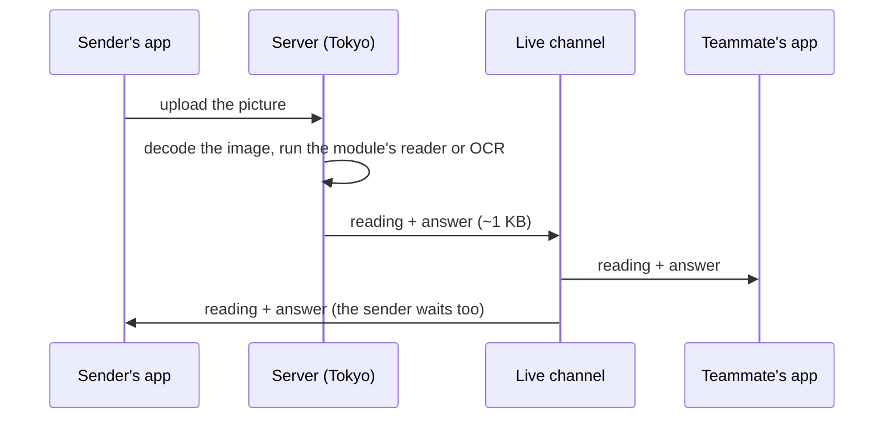
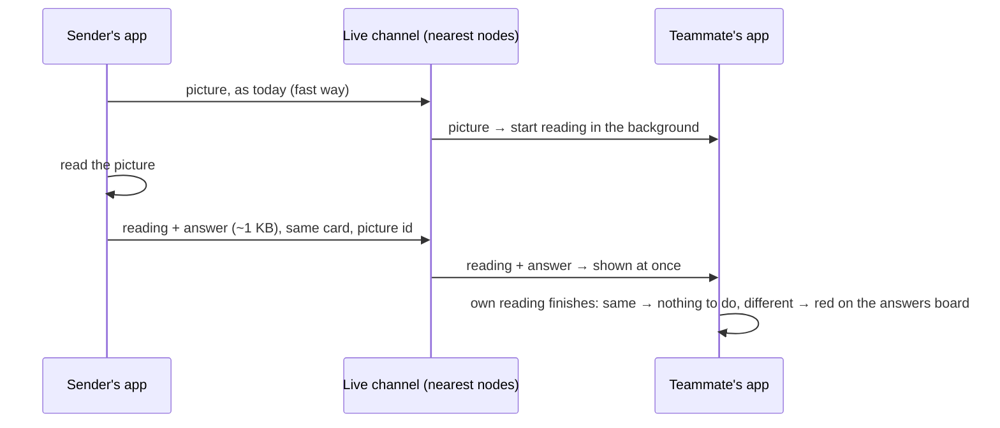
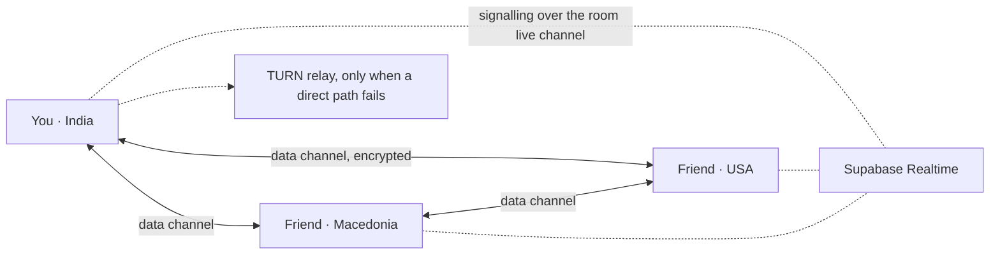
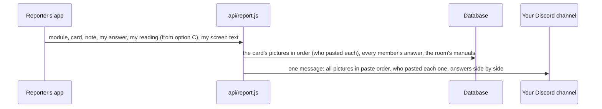
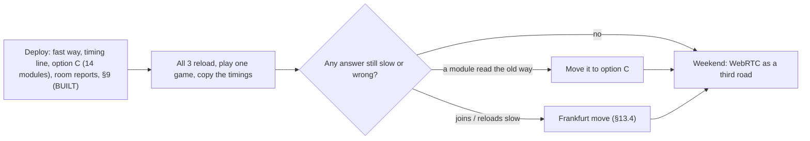
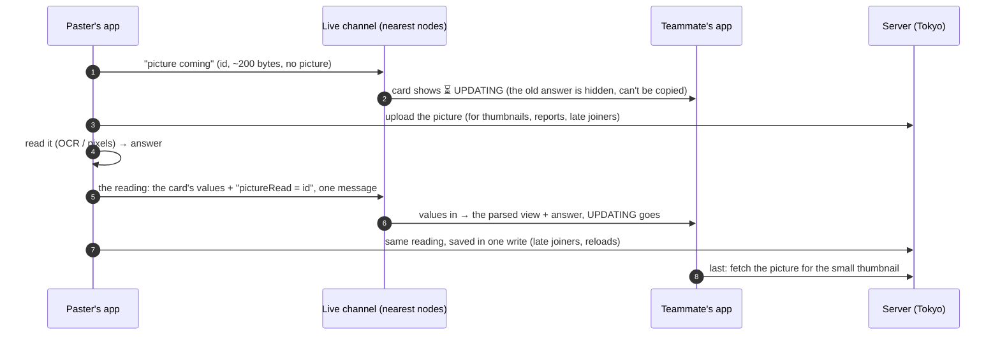

# Rooms architecture: how it works, where the time goes, what we could change

Draft for review, 26 Nov 2026. **Reviewed the same night:** your decisions are in §12 and my answers
to your questions in §13. Option C (the paster's app shares its reading), the room reports (§7) and
the small items in §9 are now BUILT.

Status tags used below:
- **LIVE**: on the site now.
- **BUILT**: in the code, live after the next `vercel --prod`.
- **IDEA**: not built.

Numbers are tagged:
- *measured*: from a real test this week;
- *estimate*: from typical distances between cities;
- *assumption*: a guess that the timing line in §9.1 would replace with real numbers.

---

## 0. My opinion in short

> **Update after your review:** you meant what option C does: the paster's own app reads the picture
> and sends the reading, the picture stays on the server and comes last. That's built (§12).

Your instinct is right that teammates only need the parsed data, not the picture. But doing the
parsing **on the server** would not make things faster for the three of you, and it costs the most
work. There are four reasons:

1. **The picture still has to travel once.** Server-side reading only saves the second leg
   (server → teammates). Ignoring internet speed, a 100 KB picture and a 1 KB answer take almost the
   same time to cross the world. Distance decides it, not size.
2. **A server sits in one place, and you're on three continents.** Every message would go
   sender → server → teammates. Today's fast way goes sender → nearest Supabase node → teammate's
   node → teammate. That's the shortest road there is short of a direct connection (WebRTC).
3. **The person who pastes would get slower.** Today their own app reads the picture the moment they
   paste, so they see the answer at once. With server-side reading they'd wait for the round trip to
   Tokyo and back.
4. **Moving 29 picture readers and the OCR engine onto Vercel functions is a big port.** The readers
   are built on the browser's canvas. You'd also pay a slow cold start whenever the 10 MB OCR model
   loads after the function has been idle, and run up against the Hobby plan's CPU limits.

What I'd do instead keeps the good parts of your idea and drops the server from the critical path:
**the app that pasted the picture is the "server" for it.** It reads the picture anyway, so it sends
its reading and answer (about 1 KB) to everyone. Teammates show that at once and check it against
their own reading in the background. That's option C in §6. The same message can carry everything a
server-side report would need (§7).

WebRTC is a fun later experiment, as a third road on top of what we have (§6, option E). It wouldn't
replace anything.

---

## 1. Words used here

| Word | Means |
|---|---|
| app | the bomb solver page running on a player's device. Each app has every module's solver |
| server | Vercel functions, mainly `api/room.js`. Short-lived, and can run as several copies at once |
| database | Supabase Postgres in Tokyo: tables `bomb_rooms`, `bomb_room_members`, `bomb_room_items`, `bomb_room_pictures` |
| live channel | Supabase Realtime: a worldwide cluster of servers. Each app connects to the nearest one |
| fast way | an app sends its change on the live channel itself (BUILT) |
| sure way | an app sends its change to the server, which checks it, saves it and sends a copy (LIVE) |
| card | one copy of a module in a room (`card:<module>:<n>`), with its list of pictures |
| reading | what a module gets out of a picture: the parsed data (a grid, words, colours …) |
| mid | the id of one change. The fast copy and the sure copy carry the same mid, so each app applies it once |

---

## 2. What runs where today

| Piece | Where | Cost | Status |
|---|---|---|---|
| The page (React, Vite, one HTML file, encrypted) | Vercel's CDN, served from the edge nearest each player | free | LIVE |
| `api/room.js` and 7 other functions | Vercel, Tokyo (`hnd1`) *measured: `bom1::hnd1`* | free (Hobby) | LIVE since 26 Nov |
| Database | Supabase, Tokyo (`ap-northeast-1`) *measured* | free plan | LIVE |
| Live channel | Supabase Realtime, nearest node per player *measured: 63 ms round trip from your PC, faster than Tokyo could answer* | free plan | LIVE |
| Fast way | each app sends on the live channel | free | BUILT |
| OCR engine (Tesseract.js, ~10 MB model) | in each browser, warmed up when the page opens | free | LIVE |

### 2.1 Is there a "shared memory pool" on the server?

There is a shared pool, but it's the **database**, not memory. The `bomb_room_items` table holds
everything the room shares: manuals, serial, counts, each card's picture list, typed inputs, answers
and the level. Every reload or late joiner reads it.

There's no shared *memory* because Vercel functions don't keep any. Each request may run on a
different copy, which shuts down when idle. A true in-memory pool needs a process that stays up.
§6 option D covers that: it would be a single place too, so it wouldn't be faster for you three.

---

## 3. What happens when someone pastes a picture (BUILT)

- Each app reads every picture itself. That was a choice, so that a misread on one device shows as a
  red row on the answers board instead of spreading to everyone.
- A reload or late joiner gets the card's picture list from the database and replays it in order.
- Files over 135 KB (about 1 in 10 module pictures *measured on the 93 test pictures*) only go the
  sure way. Teammates then download them from Tokyo.

### 3.1 A tap, a typed box, a manual (BUILT)

The same two roads carry a small JSON value (`put`). The first change goes at once. Fast typing goes
out at most every 300 ms (the latest text).

### 3.2 Joining and reloading (LIVE)

These always go to the server: about 9–11 database calls, each a few ms now that the functions sit
next to the database in Tokyo. *Estimate:* India ~0.35 s, USA ~0.4 s, Macedonia ~0.5 s.

### 3.3 A ⚑ report today (LIVE)

The pictures come from the reporter's card. In a room that card holds the room's pictures, so the
report shows exactly what was pasted. That's how the Mines report showed the defuser picture your
teammate had pasted by mistake.

---

## 4. Where the time goes for one picture

Ignoring each player's own internet speed. "Read" is the module's own work on a device. It's a few
milliseconds to ~0.1 s for pixel readers (Mines, Maze, Wires …) and *assumed* 0.2–1.5 s for the OCR
modules (Memory, Password, Who's on First, Button, Batteries, Knobs, Laundry, Echo, Bluescreen,
Balance), slower on phones.

| Step | Time | Kind |
|---|---|---|
| Sender's app turns the picture into base64 | a few ms | *assumption* |
| Travel between the nearest nodes: Macedonia ↔ USA | ~50–80 ms | *estimate* |
| Travel: India ↔ Macedonia | ~70–90 ms | *estimate* |
| Travel: India ↔ USA | ~100–130 ms | *estimate* |
| Teammate's app rebuilds the picture | a few ms | *assumption* |
| Teammate's app reads it | ms to ~1.5 s | *assumption* |
| A live message's size limit | 240 KB arrived, 300 KB was dropped (connection stayed up) | *measured* |

**So after the fast way, the biggest cost left is reading on the teammate's device, mostly OCR on
phones.** That's the thing worth attacking, and we should measure it first (§9.1).

---

## 5. Your idea: the server reads the pictures (option B)

| | |
|---|---|
| **Good** | Teammates' phones do no reading, so OCR on a slow phone stops mattering. One reading means one truth: everyone gets the same answer. The server has the picture, so reports could be built there. |
| **Bad: speed** | Path = sender → Tokyo → teammates. *Estimate:* 0.12–0.25 s of travel for your three pairs, against 0.05–0.13 s on the fast way. Plus the server's reading time. Plus a cold start when the OCR engine and its ~10 MB model load after idle (*assumption:* 1–3 s). The sender loses their instant local answer. |
| **Bad: work** | 29 reader files use the browser's canvas (`getImageData`), and the tests already fake a canvas for Node. The server would need a PNG/JPEG/GIF/WebP decoder and a canvas stand-in, plus Tesseract in a function. Then two runtimes have to stay in step whenever a reader changes. |
| **Bad: cost** | OCR is heavy CPU work. The Hobby plan limits function CPU time each month, so for a free project you could run into it. *I haven't checked the current numbers.* |
| **Bad: weak spot** | A misread on the server reaches everyone with nothing to catch it (today the answers board does). |

Speed for one picture, by option (*estimates and assumptions*, sender on a PC reading in 0.2 s,
teammate on a phone reading in 1.2 s, an OCR module, pair Macedonia ↔ USA):

| Option | Teammate sees the answer after | Sender sees it after |
|---|---|---|
| Today, fast way (BUILT) | ~0.07 s travel + 1.2 s own read ≈ **1.3 s** | 0.2 s |
| B: server reads | ~0.2 s travel + server read (~0.3 s) ≈ **0.5 s**, or 2–3 s after a cold start | ≈ 0.5 s |
| C: the paster's app shares its reading | 0.2 s + ~0.07 s ≈ **0.27 s** | 0.2 s |
| C with the race (§6) | **0.27 s** (whichever comes first) | 0.2 s |

For a pixel module (reading in ~30 ms everywhere): today ≈ 0.1 s, B ≈ 0.25 s, C ≈ 0.1 s.

---

## 6. Other options

### C. The paster's app shares its reading (BUILT for 14 modules, without the background check: §12)

- **The race.** The teammate shows whichever comes first, its own reading or the sender's. If the
  sender is on a slow phone and the teammate on a PC, the teammate's own reading wins. It's never
  slower than today.
- **What it needs.** Each module gets two small hooks: "here is my reading" (after it reads a
  picture) and "use this reading" (apply a teammate's). The reading has to be plain data: Mines' grid
  of numbers, Memory's display and button labels, Password's letter columns. Start with the slow OCR
  modules. Pixel modules gain little.
- **Late joiners and reloads.** The reading goes into the card's item too, so a reload shows it at
  once and reads the pictures in the background.
- **Cost.** Free. The messages are tiny. Medium effort: one module at a time.
- **Bonus.** Phones could skip reading pictures of modules that aren't on screen and use the shared
  reading instead. That leaves the CPU for the module you're looking at.

### D. A real "one memory pool" room server (IDEA)

A process that stays up and holds each room in memory, with websockets to every player. Two cheap
ways:
- Cloudflare Durable Objects: one object per room, with a free tier. *I haven't checked its current
  limits.*
- A small always-on server, about €4–6 a month, in Frankfurt (the middle point for India, the USA and
  Macedonia).

| | |
|---|---|
| Good | Simple model: one place holds the room. State changes are instant in memory, with no database round trip. A natural place for server-side reports. |
| Bad | It's still one place. Through Frankfurt: Macedonia ↔ USA ~60 ms, India ↔ Macedonia ~75 ms, India ↔ USA ~105 ms (*estimates*), about the same as Supabase's relay, which is free and already built. It means rewriting the server, login checks and rooms. Someone has to keep it running. |
| Verdict | Worth it only if rooms grow into something bigger. Not for speed. |

### E. WebRTC: direct device to device (IDEA, fun later)

- **Gain:** skips Supabase's nodes, maybe 10–40 ms per message (*estimate*). Bigger pictures too, sent
  in chunks.
- **Security:**
  - WebRTC encrypts data channels by default (DTLS). That's mandatory, so it's not the weak spot.
  - The real points are these:
    - Each player sees the others' IP addresses. Fine among friends, but a kicked member would have seen them.
    - Signalling must only accept room members. Using the room's secret live channel does that,
      since only members know it.
    - A TURN relay needs short-lived passwords that the server hands out, never a fixed one in the page.
- **The catch:** players on mobile data or carrier NAT often can't connect directly and need a TURN
  relay. A relay costs money or uses a free tier with limits. Your connection looked like that kind
  of network.
- **Verdict:** a fun experiment as a **third road**, with the fast way as the fallback. Not worth it
  for the speed alone.

### F. Paying for bigger plans (not recommended)

- Supabase Pro (~$25/month) raises the live message limit to about 3 MB, so every picture could go
  the fast way.
- Vercel Pro adds capacity and regions.
- More copies of the server (horizontal scaling) add capacity for many players at once. With three
  players the server is idle, so none of these makes a picture arrive sooner.

### Comparison

| Option | Speed for you three | Phone CPU | Money | Effort | Risk |
|---|---|---|---|---|---|
| Today + fast way (BUILT) | good, limited by reading on phones | each phone reads everything | free | done | low |
| B: server reads | worse travel, cold starts | none | may hit Hobby CPU limits | large (port 29 readers + OCR) | a misread spreads |
| **C: paster shares its reading** | **best** | only what's on screen | free | medium, module by module | low (each app still checks) |
| D: room server | same as today | as today | free tier or €4–6/month | large | another thing to run |
| E: WebRTC | slightly better | as today | TURN may cost | large | NAT, IP sharing |

---

## 7. Reports, rebuilt for rooms (BUILT, in addition to the normal report: §12)

Your point: the server should make the report, so it has the right pictures. For a room, I agree.
The server has every picture of every card (`bomb_room_pictures`) and every member's answer
(`ans:` items). Solo players have no server copy, so their reports stay as they are.

- Pictures pasted as Discord links aren't stored. The server would fetch them when the report is
  made, which fails if the link has expired. Or the app could upload them the moment they're pasted.
- With option C, a report also says what each app *read* from the picture. A misread then shows
  straight away.

---

## 8. Security today (LIVE + BUILT)

| What | How |
|---|---|
| Who may use rooms | Discord login, a signed session cookie, `bomb_users` allowed in `/admin` |
| The database | Row-level security on, no policies: browsers can't touch it, only the server with its secret key |
| The live channel | A 128-bit secret topic, given only to members. A kick moves the room to a new topic |
| Fast way messages | Apps can now send on the topic. Each app checks what it can: the level only from the host, an answer only from its own member, only for the current game. A member with a modified app could still send odd changes to the others. Fine among friends |
| Limits | ~10 writes/s per person, 128 KB per item, 3 MB per picture, 236 KB per fast message; a reading is at most 24 values of its own card, 128 KB together |

---

## 9. Cheap things worth doing (all free)

1. **Timing line** (BUILT). The room panel has a TIMING (THIS DEVICE) section with a COPY TIMINGS
   button (`src/core/room/roomTiming.js`). It shows:
   - the live link to each teammate, there and back (a ping on the live channel every 20 s, which
     also works out how far their clock is from yours);
   - for each of the last 8 pictures: who pasted it, fast way or from the server, its trip, the
     download, when it was in the card, and when the card's answer changed;
   - the trip of the last tap or text from a teammate.

   One game gives real numbers for §4. **Look at these before any of the bigger options.**
2. **Option C** (BUILT for 14 modules, §12).
3. **"Which module am I on" as a live message** (BUILT). It goes out the moment you switch, as a
   `where` message on the live channel. Presence still says who's online; the newer of the two wins.
4. **Answers board: send at once, then correct** (BUILT). The first answer goes at once, then the
   latest at most every 300 ms (it waited 700 ms before).
5. **Fast-way cap** (BUILT): pictures up to 170 KB go the fast way (was 135 KB), so a message is at
   most 236 KB, under the 240 KB that worked in the test. This only matters for cards not yet on
   option C: shared-reading cards never send the picture on the live channel.
6. **Read the on-screen module first** (SKIPPED). With option C, teammates don't read pictures, so
   there's nothing left to put in order. The modules still read the old way are quick pixel readers.
7. **Warm the server** (BUILT). While you're in a room with the tab open, a tiny request goes to
   the server when nothing else has for 4 minutes (`GET /api/room?action=warm`: no login, no
   database).
8. **Move the database + functions** (NOT DONE: your accounts, and see §13.4: it's off the
   critical path now).

---

## 10. Proposed order

---

## 11. Questions for you

1. Keep the background check? **Your answer: no, trust the paster** ("if they mess up, their fault";
   maybe back later). Built that way.
2. Do teammates need to see the picture? **Yes, but last:** the reading and the answer first (the
   drawn staff in Piano, the cube net in Rubik's Cube), the original picture after, as a nice-to-have.
3. Room reports: **in addition.**
4. Slowest modules? **None feel slow. The problem is updating:** the second person's answer changes
   too late, and they enter the old one. That's why the UPDATING guard exists (§12).
5. Frankfurt? **You asked about a point between India and Macedonia instead:** §13.4.
6. WebRTC? **A weekend experiment.**

---

## 12. What your review decided, and what's built (26 Nov, night)

**You meant the client parses, not the server.** The app that takes a picture reads it. Teammates
get only what it read and the answer. The picture stays on the server and reaches them last. No
`/beta` with server OCR (you dropped it: "most people have great PCs").

| Part | What it does | Where |
|---|---|---|
| Shared cards | `<Dropzone shareReading>`. Only the app that took the picture reads it. What the card changes while reading goes out in one message when the reading is done (Promise-aware: OCR modules finish first) | `Dropzone.jsx`, `roomCards.js`, `useCardState.js` |
| One write | `POST puts`: up to 24 values of one card, one database write, one live message | `api/room.js`, `lib/rooms.js putItems` |
| UPDATING | From the moment a teammate's picture arrives until its reading is in (or, for cards still read the old way, until this app has read it). Max 20 s. The answer panel shows ⏳ UPDATING — NAME'S NEW PICTURE and won't copy; the board row says ⏳ UPDATING | `AnswerPanel.jsx`, `RoomBar.jsx` |
| Picture last | A small thumbnail in the drop box, fetched after the reading is in; a tap shows it big | `Dropzone.jsx RoomPicture` |
| Fallback | No reading 6 s after a teammate's picture (a friend still on the old page, a tab closed mid-read): this app reads it itself | `roomCards.js` |
| A tap that starts a solver | `useShareWork`: Cube's sticker tap and its solution go together | `useCardState.js` |
| Room reports | After the normal ⚑ report, a second message: the card's pictures from the server in paste order (who pasted each), each player's answer, the card's values. Links are fetched only from Discord's picture servers | `api/report.js`, `lib/report.js` |
| Timing line | Shared cards show "their reading in after X ms" | `roomTiming.js` |

**Modules on shared reading (14):** Piano, Rubik's Cube, Memory, Password, Who's on First, Button,
Batteries, Word Search, Echo, Balance, Knobs, Bluescreen, Laundry, Complex Wires. That's every
text-reading (OCR) module, your two examples, and the ones whose settings were already shared.

**Still read the old way (19):** Astrology, Blackjack, Chess, Circuit, Diagram, Hangman, Limbo, Logic,
Maze, Mines, Morse, Pipes, Queens, Simon, Switches, Symbols, Wire Placement, Wires, Wire Sequence.
They're quick pixel readers. They still get the fast way and the UPDATING guard. Each needs its
picture's results moved into `useCardState`, one at a time. Simon and Wire Sequence don't use the
answer panel, so they have no UPDATING guard yet.

**After deploying:** all three of you reload. A friend on the old page never sends a reading, so their
pictures in shared cards reach you only through the 6 s fallback.

**Not checked in a browser:** there's no Chromium on this machine. 13 tests cover the room's live side
in Node, plus server tests for `puts`, `warm` and the room report.

---

## 13. Your questions, answered

### 13.1 "Database = write in disk, not memory. Wouldn't Redis be better?"

Not here. Three reasons:
- **The live path doesn't touch the database any more.** Taps, readings and answers go player →
  nearest Realtime node → player. The database only gets the "sure" copy, which nobody waits for.
- **Postgres isn't slow at this.** It keeps the data it uses in memory too, and a write is an append
  to its log. One call from the Tokyo functions to the Tokyo database takes a few ms. Redis would
  take ~1 ms. You'd save 2–5 ms against 100–250 ms of distance between you three.
- **It's another thing to keep in step.** A second store and its region, and the free tier's limits,
  for no change you'd feel.

Redis would matter if we read a room's state many times a second from the server. We don't: each
app holds the room in its own memory.

### 13.2 "They all drag the same cdn link, so how would one app misread it?"

Same bytes through the same reader usually do give the same answer. They differed when:
1. **Different app versions.** One friend hadn't reloaded since a reader fix.
2. **Different manuals or settings on each device.** A manual pasted before the room shared it, or
   the built-in table against this game's.
3. **Browsers draw pictures slightly differently.** Firefox and Chrome decode JPEGs and scale canvases
   differently, and phones cap canvas sizes. A pixel reader near a threshold can flip.
4. **OCR ran differently.** The model was still downloading on one device, a timeout fell back to
   shape guesses, or memory ran short on a phone.
5. **Order.** A second picture arrived before the first was read.

With "trust the paster", all five go away: one reading, one answer. A misread is the paster's (your
call), and the room report shows what their app read.

### 13.3 "You said always-on server. Isn't Vercel always on?"

No:
- **Functions start when a request comes and sleep when idle.** Fluid compute keeps one copy warm
  for a few minutes and lets it serve many requests at once. When it sleeps its memory is gone, and
  two requests can land on two different copies. So nothing can be kept "in memory" reliably, and
  state lives in the database. (That's also why §9.7 now keeps it warm during a game.)
- **Vercel Functions can hold WebSockets now.** But each connection lives on one copy and only for
  the function's maximum run time (minutes). Two players can sit on two different copies that don't
  share memory, so it's still not one pool.
- **Vercel Daemons** (beta) run all the time, but take no incoming connections. Players couldn't
  connect to one.
- **An always-on option:**
  - Cloudflare Durable Objects: one object per room, in memory, with a free tier;
  - a small VPS, about €4–6 a month;
  - Oracle Cloud's free VMs.

  I haven't checked current limits or regions for any of them.

  Each is still **one place**: §6 D. It's simpler, but not faster for players on different
  continents.

### 13.4 "What about the middle of India and Macedonia, ignoring the US?"

The middle is around Iran and the Gulf. **Supabase has no Middle East region.** The functions must
sit next to the database, so the real choices are Mumbai, Frankfurt or staying in Tokyo.

Since today's changes, the database only handles joins, reloads, New game, the "sure" copies and the
pictures for thumbnails and reports. **Readings, taps and answers don't go through it.** Round trip
from each player to the database (*estimates*):

| Database + functions in | You (India) | Macedonia | USA (east) | Feels like |
|---|---|---|---|---|
| Tokyo (now) | ~120–150 ms | ~250–300 ms | ~150–200 ms | joins ~0.35–0.7 s |
| Mumbai (`ap-south-1` + `bom1`) | ~10–40 ms | ~130–160 ms | ~200–250 ms | best for you |
| **Frankfurt** (`eu-central-1` + `fra1`) | ~110–140 ms | ~25–40 ms | ~90–110 ms | best for the three together |

For you and Macedonia alone, Mumbai and Frankfurt come out about even. One favours you, the other
your friend. **Frankfurt wins once the US friend plays**, so it's the one I'd pick if you move.

**My advice: don't move yet.** The slow part you described (the answer updating late) never goes
near the database now. Move only if joins or reloads still feel slow after the deploy.

Moving is free but an evening's work in your accounts: a new Supabase project in Frankfurt (a project
can't change region), the same tables (`supabase/bomb_rooms.sql`), new environment variables in
Vercel, and `"regions": ["fra1"]`.

### 13.5 WebRTC

A weekend experiment, as you said: a third road on top of the live channel, never instead of it.
The security points in §6 E still apply.
