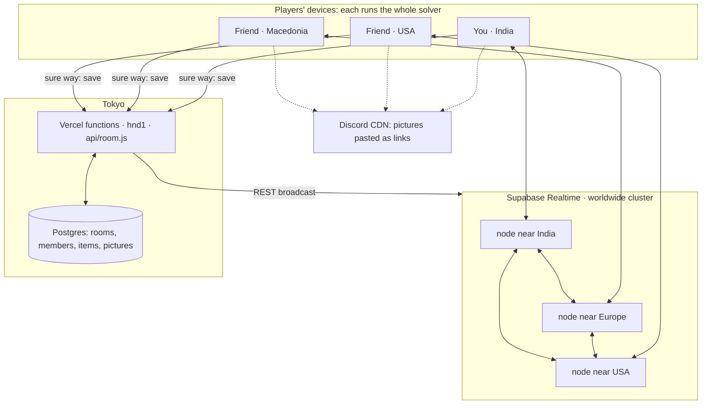
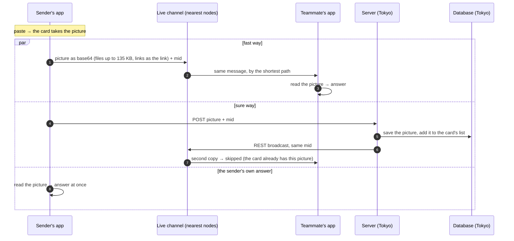
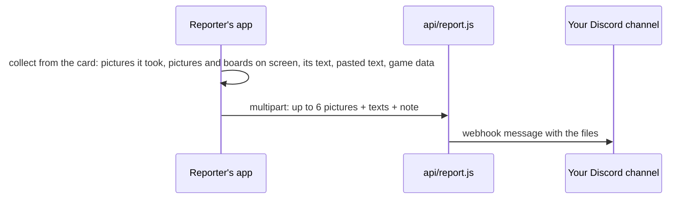
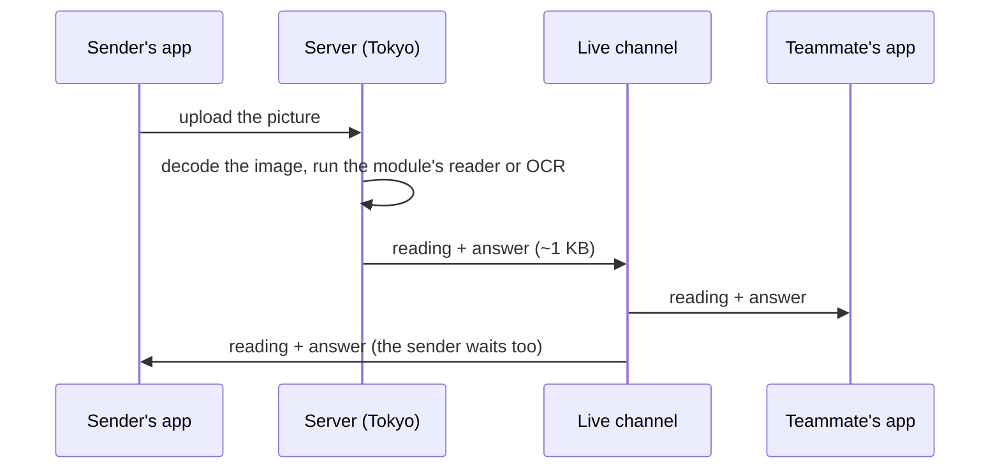
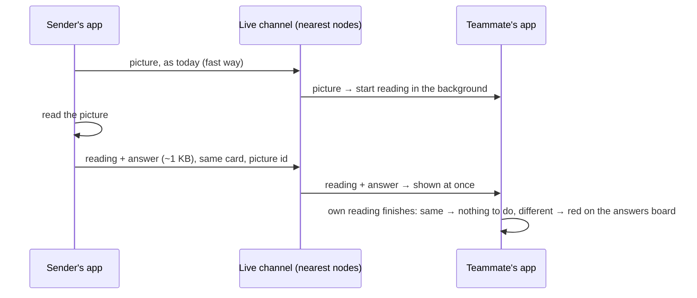
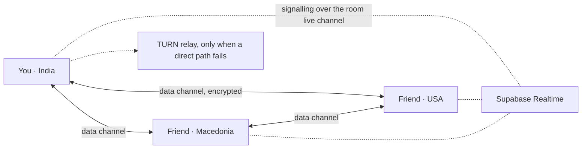
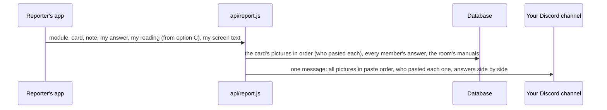
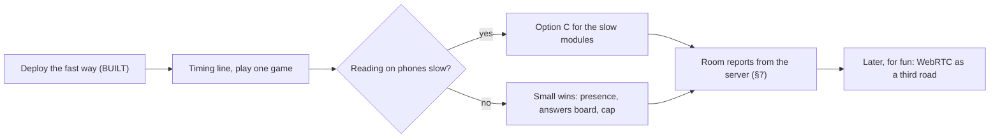

# Rooms architecture: how it works, where the time goes, what we could change

Draft for review, 26 Nov 2026. Nothing in the "options" sections is built. Write your comments
anywhere (or answer the questions at the end) and I'll fold them in.

Status tags used below:
- **LIVE**: on the site now.
- **BUILT**: in the code, live after the next `vercel --prod`.
- **IDEA**: not built.

Numbers are tagged:
- *measured*: from a real test this week;
- *estimate*: from typical distances between cities;
- *assumption*: a guess that the timing line in §9.1 would replace with real numbers.

---

## 0. My opinion in short

Your instinct is right that teammates only need the parsed data, not the picture. But doing the
parsing **on the server** would not make things faster for the three of you, and it costs the most
work. There are four reasons:

1. **The picture still has to travel once.** Server-side reading only saves the second leg
   (server → teammates). Ignoring internet speed, a 100 KB picture and a 1 KB answer take almost the
   same time to cross the world. Distance decides it, not size.
2. **A server sits in one place, and you're on three continents.** Every message would go
   sender → server → teammates. Today's fast way goes sender → nearest Supabase node → teammate's
   node → teammate. That's the shortest road there is short of a direct connection (WebRTC).
3. **The person who pastes would get slower.** Today their own app reads the picture the moment they
   paste, so they see the answer at once. With server-side reading they'd wait for the round trip to
   Tokyo and back.
4. **Moving 29 picture readers and the OCR engine onto Vercel functions is a big port.** The readers
   are built on the browser's canvas. You'd also pay a slow cold start whenever the 10 MB OCR model
   loads after the function has been idle, and run up against the Hobby plan's CPU limits.

What I'd do instead keeps the good parts of your idea and drops the server from the critical path:
**the app that pasted the picture is the "server" for it.** It reads the picture anyway, so it sends
its reading and answer (about 1 KB) to everyone. Teammates show that at once and check it against
their own reading in the background. That's option C in §6. The same message can carry everything a
server-side report would need (§7).

WebRTC is a fun later experiment, as a third road on top of what we have (§6, option E). It wouldn't
replace anything.

---

## 1. Words used here

| Word | Means |
|---|---|
| app | the bomb solver page running on a player's device. Each app has every module's solver |
| server | Vercel functions, mainly `api/room.js`. Short-lived, and can run as several copies at once |
| database | Supabase Postgres in Tokyo: tables `bomb_rooms`, `bomb_room_members`, `bomb_room_items`, `bomb_room_pictures` |
| live channel | Supabase Realtime: a worldwide cluster of servers. Each app connects to the nearest one |
| fast way | an app sends its change on the live channel itself (BUILT) |
| sure way | an app sends its change to the server, which checks it, saves it and sends a copy (LIVE) |
| card | one copy of a module in a room (`card:<module>:<n>`), with its list of pictures |
| reading | what a module gets out of a picture: the parsed data (a grid, words, colours …) |
| mid | the id of one change. The fast copy and the sure copy carry the same mid, so each app applies it once |

---

## 2. What runs where today

| Piece | Where | Cost | Status |
|---|---|---|---|
| The page (React, Vite, one HTML file, encrypted) | Vercel's CDN, served from the edge nearest each player | free | LIVE |
| `api/room.js` and 7 other functions | Vercel, Tokyo (`hnd1`) *measured: `bom1::hnd1`* | free (Hobby) | LIVE since 26 Nov |
| Database | Supabase, Tokyo (`ap-northeast-1`) *measured* | free plan | LIVE |
| Live channel | Supabase Realtime, nearest node per player *measured: 63 ms round trip from your PC, faster than Tokyo could answer* | free plan | LIVE |
| Fast way | each app sends on the live channel | free | BUILT |
| OCR engine (Tesseract.js, ~10 MB model) | in each browser, warmed up when the page opens | free | LIVE |

### 2.1 Is there a "shared memory pool" on the server?

There is a shared pool, but it's the **database**, not memory. The `bomb_room_items` table holds
everything the room shares: manuals, serial, counts, each card's picture list, typed inputs, answers
and the level. Every reload or late joiner reads it.

There's no shared *memory* because Vercel functions don't keep any. Each request may run on a
different copy, which shuts down when idle. A true in-memory pool needs a process that stays up.
§6 option D covers that: it would be a single place too, so it wouldn't be faster for you three.

---

## 3. What happens when someone pastes a picture (BUILT)

- Each app reads every picture itself. That was a choice, so that a misread on one device shows as a
  red row on the answers board instead of spreading to everyone.
- A reload or late joiner gets the card's picture list from the database and replays it in order.
- Files over 135 KB (about 1 in 10 module pictures *measured on the 93 test pictures*) only go the
  sure way. Teammates then download them from Tokyo.

### 3.1 A tap, a typed box, a manual (BUILT)

The same two roads carry a small JSON value (`put`). The first change goes at once. Fast typing goes
out at most every 300 ms (the latest text).

### 3.2 Joining and reloading (LIVE)

These always go to the server: about 9–11 database calls, each a few ms now that the functions sit
next to the database in Tokyo. *Estimate:* India ~0.35 s, USA ~0.4 s, Macedonia ~0.5 s.

### 3.3 A ⚑ report today (LIVE)

The pictures come from the reporter's card. In a room that card holds the room's pictures, so the
report shows exactly what was pasted. That's how the Mines report showed the defuser picture your
teammate had pasted by mistake.

---

## 4. Where the time goes for one picture

Ignoring each player's own internet speed. "Read" is the module's own work on a device. It's a few
milliseconds to ~0.1 s for pixel readers (Mines, Maze, Wires …) and *assumed* 0.2–1.5 s for the OCR
modules (Memory, Password, Who's on First, Button, Batteries, Knobs, Laundry, Echo, Bluescreen,
Balance), slower on phones.

| Step | Time | Kind |
|---|---|---|
| Sender's app turns the picture into base64 | a few ms | *assumption* |
| Travel between the nearest nodes: Macedonia ↔ USA | ~50–80 ms | *estimate* |
| Travel: India ↔ Macedonia | ~70–90 ms | *estimate* |
| Travel: India ↔ USA | ~100–130 ms | *estimate* |
| Teammate's app rebuilds the picture | a few ms | *assumption* |
| Teammate's app reads it | ms to ~1.5 s | *assumption* |
| A live message's size limit | 240 KB arrived, 300 KB was dropped (connection stayed up) | *measured* |

**So after the fast way, the biggest cost left is reading on the teammate's device, mostly OCR on
phones.** That's the thing worth attacking, and we should measure it first (§9.1).

---

## 5. Your idea: the server reads the pictures (option B)

| | |
|---|---|
| **Good** | Teammates' phones do no reading, so OCR on a slow phone stops mattering. One reading means one truth: everyone gets the same answer. The server has the picture, so reports could be built there. |
| **Bad: speed** | Path = sender → Tokyo → teammates. *Estimate:* 0.12–0.25 s of travel for your three pairs, against 0.05–0.13 s on the fast way. Plus the server's reading time. Plus a cold start when the OCR engine and its ~10 MB model load after idle (*assumption:* 1–3 s). The sender loses their instant local answer. |
| **Bad: work** | 29 reader files use the browser's canvas (`getImageData`), and the tests already fake a canvas for Node. The server would need a PNG/JPEG/GIF/WebP decoder and a canvas stand-in, plus Tesseract in a function. Then two runtimes have to stay in step whenever a reader changes. |
| **Bad: cost** | OCR is heavy CPU work. The Hobby plan limits function CPU time each month, so for a free project you could run into it. *I haven't checked the current numbers.* |
| **Bad: weak spot** | A misread on the server reaches everyone with nothing to catch it (today the answers board does). |

Speed for one picture, by option (*estimates and assumptions*, sender on a PC reading in 0.2 s,
teammate on a phone reading in 1.2 s, an OCR module, pair Macedonia ↔ USA):

| Option | Teammate sees the answer after | Sender sees it after |
|---|---|---|
| Today, fast way (BUILT) | ~0.07 s travel + 1.2 s own read ≈ **1.3 s** | 0.2 s |
| B: server reads | ~0.2 s travel + server read (~0.3 s) ≈ **0.5 s**, or 2–3 s after a cold start | ≈ 0.5 s |
| C: the paster's app shares its reading | 0.2 s + ~0.07 s ≈ **0.27 s** | 0.2 s |
| C with the race (§6) | **0.27 s** (whichever comes first) | 0.2 s |

For a pixel module (reading in ~30 ms everywhere): today ≈ 0.1 s, B ≈ 0.25 s, C ≈ 0.1 s.

---

## 6. Other options

### C. The paster's app shares its reading (IDEA, my recommendation)

- **The race.** The teammate shows whichever comes first, its own reading or the sender's. If the
  sender is on a slow phone and the teammate on a PC, the teammate's own reading wins. It's never
  slower than today.
- **What it needs.** Each module gets two small hooks: "here is my reading" (after it reads a
  picture) and "use this reading" (apply a teammate's). The reading has to be plain data: Mines' grid
  of numbers, Memory's display and button labels, Password's letter columns. Start with the slow OCR
  modules. Pixel modules gain little.
- **Late joiners and reloads.** The reading goes into the card's item too, so a reload shows it at
  once and reads the pictures in the background.
- **Cost.** Free. The messages are tiny. Medium effort: one module at a time.
- **Bonus.** Phones could skip reading pictures of modules that aren't on screen and use the shared
  reading instead. That leaves the CPU for the module you're looking at.

### D. A real "one memory pool" room server (IDEA)

A process that stays up and holds each room in memory, with websockets to every player. Two cheap
ways:
- Cloudflare Durable Objects: one object per room, with a free tier. *I haven't checked its current
  limits.*
- A small always-on server, about €4–6 a month, in Frankfurt (the middle point for India, the USA and
  Macedonia).

| | |
|---|---|
| Good | Simple model: one place holds the room. State changes are instant in memory, with no database round trip. A natural place for server-side reports. |
| Bad | It's still one place. Through Frankfurt: Macedonia ↔ USA ~60 ms, India ↔ Macedonia ~75 ms, India ↔ USA ~105 ms (*estimates*), about the same as Supabase's relay, which is free and already built. It means rewriting the server, login checks and rooms. Someone has to keep it running. |
| Verdict | Worth it only if rooms grow into something bigger. Not for speed. |

### E. WebRTC: direct device to device (IDEA, fun later)

- **Gain:** skips Supabase's nodes, maybe 10–40 ms per message (*estimate*). Bigger pictures too, sent
  in chunks.
- **Security:**
  - WebRTC encrypts data channels by default (DTLS). That's mandatory, so it's not the weak spot.
  - The real points are these:
    - Each player sees the others' IP addresses. Fine among friends, but a kicked member would have seen them.
    - Signalling must only accept room members. Using the room's secret live channel does that,
      since only members know it.
    - A TURN relay needs short-lived passwords that the server hands out, never a fixed one in the page.
- **The catch:** players on mobile data or carrier NAT often can't connect directly and need a TURN
  relay. A relay costs money or uses a free tier with limits. Your connection looked like that kind
  of network.
- **Verdict:** a fun experiment as a **third road**, with the fast way as the fallback. Not worth it
  for the speed alone.

### F. Paying for bigger plans (not recommended)

- Supabase Pro (~$25/month) raises the live message limit to about 3 MB, so every picture could go
  the fast way.
- Vercel Pro adds capacity and regions.
- More copies of the server (horizontal scaling) add capacity for many players at once. With three
  players the server is idle, so none of these makes a picture arrive sooner.

### Comparison

| Option | Speed for you three | Phone CPU | Money | Effort | Risk |
|---|---|---|---|---|---|
| Today + fast way (BUILT) | good, limited by reading on phones | each phone reads everything | free | done | low |
| B: server reads | worse travel, cold starts | none | may hit Hobby CPU limits | large (port 29 readers + OCR) | a misread spreads |
| **C: paster shares its reading** | **best** | only what's on screen | free | medium, module by module | low (each app still checks) |
| D: room server | same as today | as today | free tier or €4–6/month | large | another thing to run |
| E: WebRTC | slightly better | as today | TURN may cost | large | NAT, IP sharing |

---

## 7. Reports, rebuilt for rooms (IDEA)

Your point: the server should make the report, so it has the right pictures. For a room, I agree.
The server has every picture of every card (`bomb_room_pictures`) and every member's answer
(`ans:` items). Solo players have no server copy, so their reports stay as they are.

- Pictures pasted as Discord links aren't stored. The server would fetch them when the report is
  made, which fails if the link has expired. Or the app could upload them the moment they're pasted.
- With option C, a report also says what each app *read* from the picture. A misread then shows
  straight away.

---

## 8. Security today (LIVE + BUILT)

| What | How |
|---|---|
| Who may use rooms | Discord login, a signed session cookie, `bomb_users` allowed in `/admin` |
| The database | Row-level security on, no policies: browsers can't touch it, only the server with its secret key |
| The live channel | A 128-bit secret topic, given only to members. A kick moves the room to a new topic |
| Fast way messages | Apps can now send on the topic. Each app checks what it can: the level only from the host, an answer only from its own member, only for the current game. A member with a modified app could still send odd changes to the others. Fine among friends |
| Limits | ~10 writes/s per person, 128 KB per item, 3 MB per picture, 180 KB per fast message |

---

## 9. Cheap things worth doing (all free)

1. **Timing line** (IDEA, ~1 h). The room panel shows, on each device: "last picture: arrived
   in X ms, read in Y ms". One game gives real numbers for §4. **Do this before any of the bigger
   options.**
2. **Option C for the OCR modules** (IDEA, medium). The biggest real gain on phones.
3. **"Which module am I on" as a live message instead of presence** (IDEA, small). Presence allows 5
   updates per 30 s, so it lags up to 6 s. A broadcast message would make it instant.
4. **Answers board: send at once, then correct** (IDEA, small). It now waits 700 ms for an answer to
   settle.
5. **Raise the fast-way cap from 135 KB to ~170 KB** (IDEA, tiny). A few more pictures skip Tokyo.
   240 KB worked in the test.
6. **Read the on-screen module first** (IDEA, small). Pictures for other modules wait their turn on
   a phone.
7. **Warm the server when entering a room** (IDEA, tiny). One call, so the first save doesn't hit a
   cold start. Barely matters with the fast way.
8. **Move the database + functions to Frankfurt** (IDEA, an evening, your accounts). Only helps
   joins, reloads, big pictures and New game for your friends.

---

## 10. Proposed order

---

## 11. Questions for you

1. Option C keeps "every app checks the picture itself" in the background. Do you want to keep that
   check? Or trust the paster's reading fully, which is simpler and saves phone CPU, but a misread
   then spreads?
2. Do teammates need to *see* the picture? Or is the reading + answer enough, with the picture
   loading only when they open the card?
3. Room reports from the server (§7): should they replace the current report in rooms, or come in
   addition?
4. Which modules feel slowest in real games? That decides where option C starts.
5. Frankfurt move: worth an evening, or leave Tokyo?
6. WebRTC: want it as a weekend experiment after the above, knowing it's for fun more than speed?
